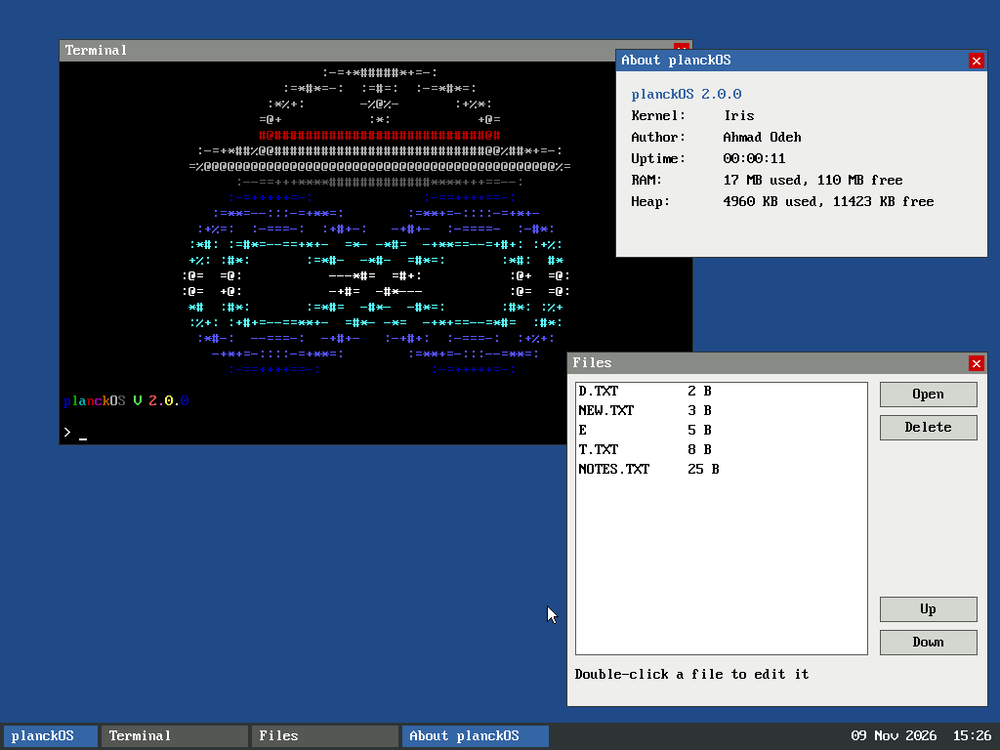

# planckOS

planckOS is a small hobby operating system for 32-bit x86 PCs, written in
C and NASM by Ahmad Odeh. Its kernel is called **Iris**. It boots with GRUB
(Multiboot 1), runs in QEMU, and gives you a simple graphical desktop:
windows you can drag, a taskbar, a terminal, a file browser and a text
editor that saves to a FAT12 disk.

It's meant to be read: the code is split into small, commented
subsystems, and `docs/` explains how each one works.



## Features

- **Boot:** GRUB Multiboot 1, 1024x768x32 framebuffer, falls back to a
  text-mode shell when there is no framebuffer
- **CPU:** GDT, IDT, remapped 8259 PIC, PIT timer at 100 Hz, `int 0x80`
  system calls
- **Memory:** bitmap physical page allocator, paging (64 MB identity map
  plus on-demand mappings), 16 MB kernel heap
- **Drivers:** PS/2 keyboard and mouse, ATA PIO disk, VGA text, CMOS
  real-time clock, COM1 serial log, emulator power-off
- **File system:** FAT12 (root directory): list, read, write, delete
- **Graphics:** back-buffered framebuffer, surfaces, 8x16 bitmap font
- **Desktop:** event queue, window manager (z-order, focus, dragging,
  close), taskbar with clock, launcher menu, widget helpers
- **Apps:** Terminal, Files, Notepad (cursor keys, line numbers,
  scrolling), Clock, About, Shut down
- **Programs:** an ELF loader and an `exec` shell command that run
  programs from the disk. Programs can open their own windows, draw in
  them and react to keys, clicks and a timer through callbacks (examples:
  `programs/hello.c`, `programs/click.c`, `programs/click.asm`)
- **Assembler:** a built-in two-pass x86 assembler (`asm` command) that
  turns NASM-style source into runnable programs, so you can write, build
  and run assembly entirely inside planckOS. Its output is checked byte for
  byte against NASM (`make asm-test`).

## Build and run

You need `i686-elf-gcc` (or `gcc` with 32-bit support), `nasm`,
`grub-mkrescue` (`i686-elf-grub-mkrescue` on macOS), `xorriso` and
`qemu-system-i386`. See [docs/BUILDING.md](docs/BUILDING.md) for install
commands.

```sh
make            # build build/planckOS.iso
make disk       # create an empty FAT12 disk.img (only if missing)
make run        # boot it in QEMU; the serial log appears in your terminal
```

In the QEMU window, click the **planckOS** button at the bottom left to open
apps. Click inside the window to capture the mouse, and press Ctrl+Alt+G to
release it.

## Documentation

| Page | Covers |
|------|--------|
| [ARCHITECTURE](docs/ARCHITECTURE.md) | The big picture: boot sequence, memory map, folders, how the parts fit together |
| [BUILDING](docs/BUILDING.md) | Toolchain, make targets, running and debugging in QEMU |
| [BOOT](docs/BOOT.md) | GRUB, the Multiboot header, the linker script, `kmain` |
| [MEMORY](docs/MEMORY.md) | Physical memory manager, paging, the heap |
| [INTERRUPTS](docs/INTERRUPTS.md) | GDT, IDT, PIC, system calls |
| [DRIVERS](docs/DRIVERS.md) | Serial, timer, RTC, VGA, keyboard, mouse, ATA, FAT12, power |
| [GRAPHICS](docs/GRAPHICS.md) | Framebuffer, surfaces, font |
| [INPUT](docs/INPUT.md) | The event queue and how input reaches apps |
| [GUI](docs/GUI.md) | Main loop, window manager, taskbar, launcher, widgets |
| [APPS](docs/APPS.md) | The built-in apps, and a tutorial for writing your own |
| [EXEC](docs/EXEC.md) | Loading and running ELF programs, and how to write one |
| [PROGRAMS_GUI](docs/PROGRAMS_GUI.md) | Windows for programs: system calls, callbacks, lifetime rules |
| [ASSEMBLER](docs/ASSEMBLER.md) | The built-in assembler: syntax, two passes, x86 encoding, adding instructions |
| [ROADMAP](docs/ROADMAP.md) | What's done and good next steps |

## History

The original text-mode version of planckOS (VGA text console and a command shell)
is preserved as the tag `v1.0-text` and the branch `legacy/text-shell`.
To check it out:

```sh
git checkout v1.0-text            # read-only snapshot (detached HEAD)
git checkout legacy/text-shell    # or as a branch you can build on
```

## License

GNU General Public License v3.0, see [LICENSE](LICENSE). The 8x16 font data
comes from SeaBIOS's VGA BIOS (GNU LGPL v3), see `src/gfx/font.c`.
