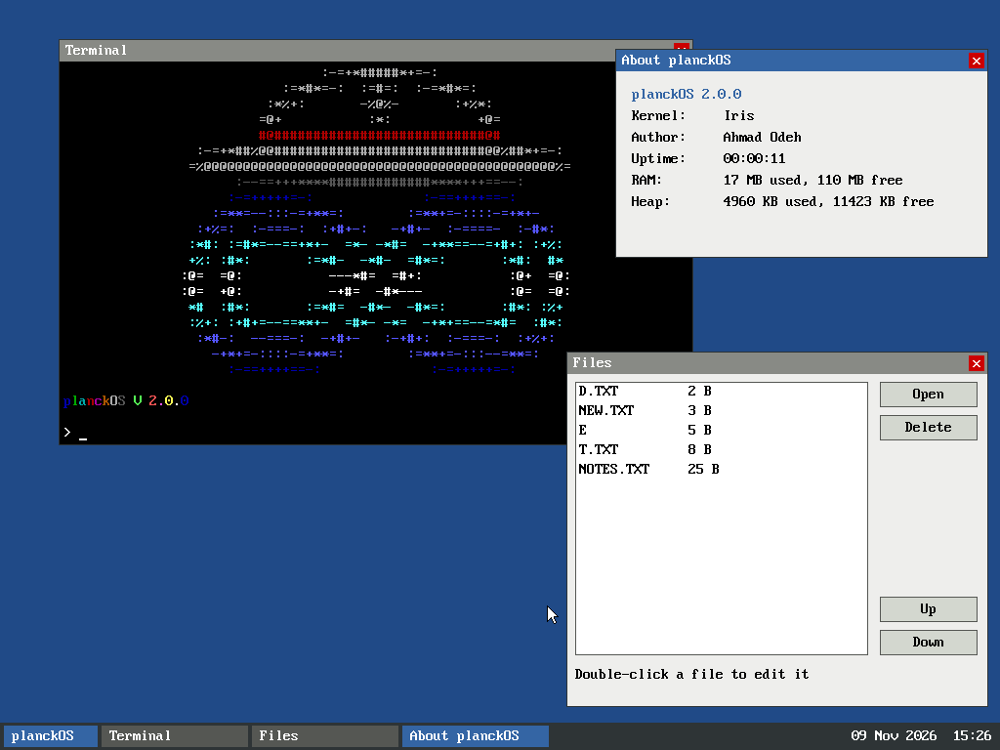
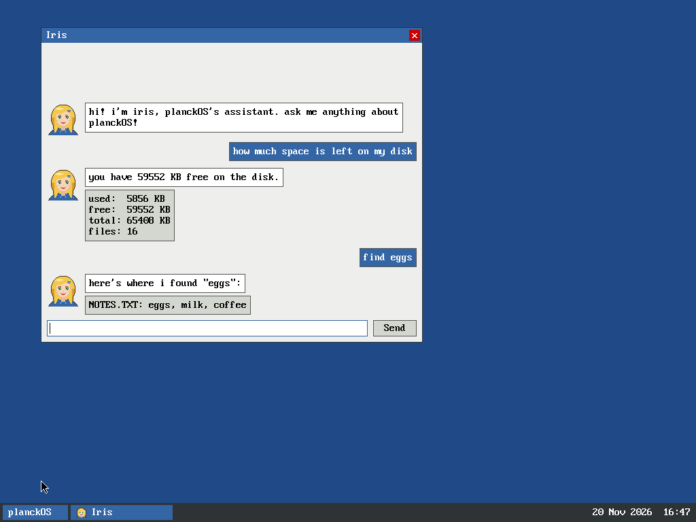
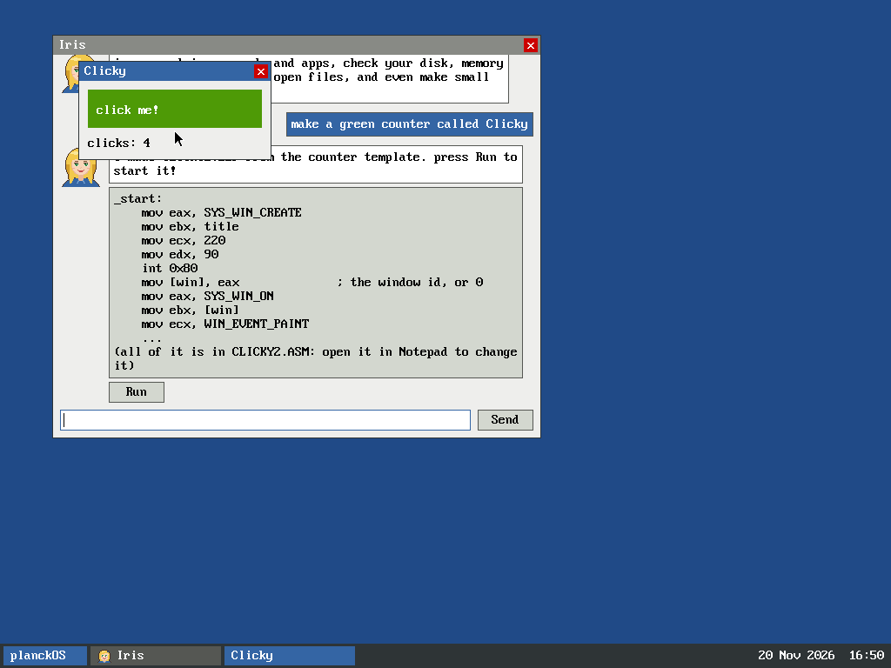

# planckOS

planckOS is a small hobby operating system for 32-bit x86 PCs, written in
C and NASM by Ahmad Odeh. Its kernel is called **Iris**. It boots with GRUB
(Multiboot 1), runs in QEMU, and gives you a simple graphical desktop:
windows you can drag, a taskbar, a terminal, a file browser and a text
editor that saves to a FAT12 disk.

It's meant to be read: the code is split into small, commented
subsystems, and `docs/` explains how each one works.



Iris, the assistant, checking the disk and searching files, and running a
counter app she made from a template:




## Features

- **Boot:** GRUB Multiboot 1, 1024x768x32 framebuffer, falls back to a
  text-mode shell when there is no framebuffer
- **CPU:** GDT, IDT, remapped 8259 PIC, PIT timer at 100 Hz, `int 0x80`
  system calls
- **Memory:** bitmap physical page allocator, paging (64 MB identity map
  plus on-demand mappings), 16 MB kernel heap
- **Drivers:** PS/2 keyboard and mouse, ATA PIO disk, VGA text, CMOS
  real-time clock, COM1 serial log, emulator power-off
- **File system:** FAT12 (root directory): list, read, write, delete
- **Graphics:** back-buffered framebuffer, surfaces, 8x16 bitmap font
- **Desktop:** event queue, window manager (z-order, focus, dragging,
  close), taskbar with clock, launcher menu, widget helpers
- **Apps:** Terminal, Files, Notepad (cursor keys, line numbers,
  scrolling), Clock, About, Iris (a chat assistant), Shut down
- **Programs:** an ELF loader and an `exec` shell command that run
  programs from the disk. Programs can open their own windows, draw in
  them and react to keys, clicks and a timer through callbacks (examples:
  `programs/hello.c`, `programs/click.c`, `programs/click.asm`)
- **Assembler:** a built-in two-pass x86 assembler (`asm` command) that
  turns NASM-style source into runnable programs, so you can write, build
  and run assembly entirely inside planckOS. Its output is checked byte for
  byte against NASM (`make asm-test`).
- **Higgson:** planckOS's own programming language, with a C-like syntax
  and a compiler inside the OS (`higgson` command): write a program in
  Notepad, compile it and run it, including GUI apps with a window, mouse,
  keyboard and timer (examples: `programs/*.hgs`). The same compiler
  builds on your computer (`make higgson-host`)
- **Language models:** a port of llama2.c's `run.c` runs small Llama 2
  models on the x87 FPU; `llm-test` checks it token for token against
  llama2.c (`make models` downloads the test model)
- **Iris:** a chat assistant, the voice of the kernel. A 1-million-
  parameter model trained on conversations about planckOS
  (`make chat-model`), in her own app or in the Terminal (`iris`). Fact
  cards show the exact help next to her answers, and she uses tools: she
  checks the disk, memory and time, finds and opens files, and makes small
  apps from tested templates

## Quick start

```sh
git clone https://github.com/ahmadodeh9000/planckOS.git
cd planckOS
make run
```

`make run` does everything: it checks that the tools below are installed
(and says exactly what to install if one isn't), builds planckOS, creates
`disk.img`, downloads Iris's model (checked by SHA-256), copies the model
and the example programs onto the disk, and boots it in QEMU. Run it again
any time: it only rebuilds, downloads and copies what changed, and it
never overwrites files you made on the disk.

Then click the **planckOS** button at the bottom left and choose **Iris**
to talk to the assistant, or **Terminal** to type commands. Click inside
the QEMU window to capture the mouse, and press Ctrl+Alt+G to release it.

**Install these first:**

- **macOS** ([Homebrew](https://brew.sh)):
  ```sh
  brew install i686-elf-gcc i686-elf-grub nasm xorriso qemu mtools
  ```
- **Linux** (Debian, Ubuntu):
  ```sh
  sudo apt install gcc gcc-multilib nasm grub-pc-bin grub-common xorriso qemu-system-x86 mtools dosfstools curl
  ```
- **Windows:** install [WSL2](https://learn.microsoft.com/windows/wsl/install)
  with Ubuntu, then use the Linux command inside it. QEMU's window opens
  through WSLg on Windows 11; on Windows 10, use `make run-headless`.

`make run-headless` does the same without a window (the serial log appears
in your terminal). [docs/BUILDING.md](docs/BUILDING.md) lists every make
target. To teach Iris new things and retrain her yourself, see
[docs/TRAINING.md](docs/TRAINING.md).

## Documentation

| Page | Covers |
|------|--------|
| [ARCHITECTURE](docs/ARCHITECTURE.md) | The big picture: boot sequence, memory map, folders, how the parts fit together |
| [BUILDING](docs/BUILDING.md) | Toolchain, make targets, running and debugging in QEMU |
| [BOOT](docs/BOOT.md) | GRUB, the Multiboot header, the linker script, `kmain` |
| [MEMORY](docs/MEMORY.md) | Physical memory manager, paging, the heap |
| [INTERRUPTS](docs/INTERRUPTS.md) | GDT, IDT, PIC, the x87 FPU, system calls |
| [DRIVERS](docs/DRIVERS.md) | Serial, timer, RTC, VGA, keyboard, mouse, ATA, FAT12, power |
| [GRAPHICS](docs/GRAPHICS.md) | Framebuffer, surfaces, font |
| [INPUT](docs/INPUT.md) | The event queue and how input reaches apps |
| [GUI](docs/GUI.md) | Main loop, window manager, taskbar, launcher, widgets |
| [APPS](docs/APPS.md) | The built-in apps, and a tutorial for writing your own |
| [EXEC](docs/EXEC.md) | Loading and running ELF programs, and how to write one |
| [PROGRAMS_GUI](docs/PROGRAMS_GUI.md) | Windows for programs: system calls, callbacks, lifetime rules |
| [ASSEMBLER](docs/ASSEMBLER.md) | The built-in assembler: syntax, two passes, x86 encoding, adding instructions |
| [HIGGSON](docs/HIGGSON.md) | Higgson, planckOS's programming language, for beginners: the language, GUI apps, how the compiler works |
| [LLM](docs/LLM.md) | Language models: the transformer step by step, the file format, the x87 math, Iris's fact cards and tools |
| [TRAINING](docs/TRAINING.md) | Training Iris, for beginners: what training is, `make chat-model`, the settings, retraining |
| [ROADMAP](docs/ROADMAP.md) | What's done and good next steps |

## History

The original text-mode version of planckOS (VGA text console and a command shell)
is preserved as the tag `v1.0-text` and the branch `legacy/text-shell`.
To check it out:

```sh
git checkout v1.0-text            # read-only snapshot (detached HEAD)
git checkout legacy/text-shell    # or as a branch you can build on
```

## License

GNU General Public License v3.0, see [LICENSE](LICENSE). The 8x16 font data
comes from SeaBIOS's VGA BIOS (GNU LGPL v3), see `src/gfx/font.c`.

## Credits

- `src/llm/` is a port of `run.c` from
  [llama2.c](https://github.com/karpathy/llama2.c) by Andrej Karpathy (MIT
  license, see `src/llm/LICENSE.llama2c`).
- The test model `stories260K` and its tokenizer come from
  [karpathy/tinyllamas](https://huggingface.co/karpathy/tinyllamas) (MIT
  license), trained on the
  [TinyStories](https://huggingface.co/datasets/roneneldan/TinyStories)
  dataset (CDLA-Sharing-1.0). They're downloaded by `make models`, not
  stored in this repository.
- Iris is trained with llama2.c's `train.py` (MIT license), SentencePiece
  (Apache 2.0) and PyTorch (BSD-style), on conversations written for
  planckOS (`training/my_chats.txt`, `more_chats.txt`, `my_tools.txt`); no public
  dataset is used. The trained model is published as assets of the GitHub
  release `iris-v2` under the GNU GPL v3, like the rest of planckOS, and
  `make models` downloads it; it isn't stored in this repository. Details:
  `models/README.md` and `src/llm/CREDITS.md`.
- Iris's portrait (`src/apps/iris_avatar.c`) is original pixel art made
  for planckOS.
- The Higgson compiler (`src/higgson/`) follows the design of Austin
  Henley's tutorial
  [*Let's make a Teeny Tiny compiler*](https://austinhenley.com/blog/teenytinycompiler1.html).
