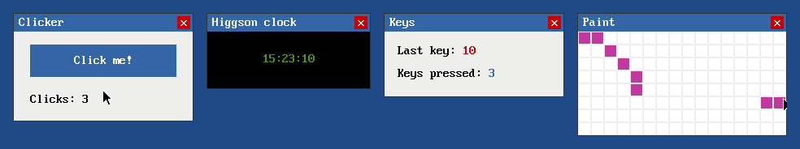

# Higgson

Higgson is planckOS's own programming language, named after the Higgs
boson to go with planckOS's physics theme. You write a program in Notepad,
compile it with the `higgson` command, and run it with `exec`, all inside
planckOS. Programs can print to the Terminal, or open a window, draw in it
and react to the mouse, the keyboard and the clock.

The compiler turns a Higgson program into planckOS assembly, which the
built-in assembler (`ASSEMBLER.md`) turns into a program. It started as
`planckBASIC`, a BASIC compiler written by following Austin Henley's
*Teeny Tiny Compiler* tutorial (see Credits), and now has a C-like syntax.

## Using it

Open a Terminal (planckOS button, Terminal) and try an example that
`make run` put on the disk:

```
higgson FIB.HGS FIB.ELF     compile to a program, then: exec FIB.ELF
higgson FIB.HGS FIB.ASM     write the assembly instead, to read in Notepad
```

To write your own, open Notepad, type a program, save it as `MY.HGS`,
and compile it the same way.

The assembly goes from the compiler to the assembler in memory; only the
finished program is written to the disk. An error stops the compile and
says where:

```
higgson: FIB.HGS line 5: expected ';' after statement
```

and nothing is written. Source files can be up to 32 KB.

## The language

A Higgson program looks like a small C program without types: every
value is a whole number (a 32-bit signed int).

```
// fib.hgs: the first 10 Fibonacci numbers
let a = 0;
let b = 1;
let n = 0;
while (n < 10) {
    print(a);
    let next = a + b;
    a = b;
    b = next;
    n = n + 1;
}
```

### Statements

| Statement | What it does |
|---|---|
| `let x = 5;` | declares the variable `x` and gives it a value |
| `x = x + 1;` | gives an existing variable a new value |
| `print("hello");` | prints a string and a newline |
| `print(x * 2);` | prints a number and a newline |
| `if (x > 3) { ... }` | runs the block if the condition isn't 0 |
| `if (...) { ... } else { ... }` | one block or the other; `else if (...)` works too |
| `while (n > 0) { ... }` | runs the block again and again while the condition isn't 0 |
| `func name() { ... }` | defines a function (no parameters yet) |
| `name();` | calls a function |
| `return;` | leaves a function early (in the main code: ends the program) |

Every statement ends with `;`, except the ones that end with a `}` block.
Keywords are lowercase. Comments are `// to the end of the line` and
`/* anything, even several lines */`.

**Variables** must be declared with `let` before they're used, further
up in the file. Every variable is global: one variable for the whole
program, even if its `let` is inside a function. A second `let` with the
same name is an error.

**Functions** can be defined anywhere at the top level, before or after
the code that calls them, but not inside another function or inside
`if` or `while`. They take no parameters and give back no value; they
work with the (global) variables.

**The main code** is everything outside functions. It runs from top to
bottom when the program starts; function bodies run only when called.

### Values and operators

Numbers are written in decimal (`42`, up to 2147483647) or hex
(`0xFF8800`, up to `0xFFFFFFFF`). There are no decimals and no strings in
calculations; strings only appear in `print` (and, for apps, `text`).

From loosest to tightest, as in C:

| Operators | Meaning |
|---|---|
| `\|\|` | or: 1 if either side isn't 0 |
| `&&` | and: 1 if both sides aren't 0 |
| `==` `!=` | equal, not equal (1 or 0) |
| `<` `<=` `>` `>=` | comparisons (1 or 0) |
| `+` `-` | add, subtract |
| `*` `/` `%` | multiply, divide, remainder (rounded toward 0, as in C) |
| `-x` `!x` | minus, not (`!x` is 1 when x is 0) |

`&&` and `||` stop early, as in C: in `a && b`, `b` isn't computed if `a`
is 0. Dividing by 0 stops the program (`exec` reports a crash).

### Errors

The compiler stops at the first error and says which line it's on:

```
higgson: FIB.HGS line 4: expected ';' after statement
higgson: FIB.HGS line 7: unknown variable 'cuont'
higgson: FIB.HGS line 9: unknown function 'drwa'
higgson: FIB.HGS line 3: this '{' is never closed with '}'
higgson: FIB.HGS line 2: this string is never closed with "
higgson: FIB.HGS line 5: unknown character '@'
```

A missing `;` is reported on the line of the statement that needs it,
and an unclosed `{` on the line where it opens.

## GUI apps

A Higgson program can open a window, draw in it, and react to the mouse,
the keyboard and the clock. It uses the same window calls as assembly and
C programs (`PROGRAMS_GUI.md`).

### The event model

A GUI program doesn't run in a loop waiting for things to happen.
Instead:

1. The main code runs once: it opens the window with `window()` and says
   which func handles which event (`on_paint(draw);`, `on_click(clicked);`).
2. The main code ends. The program stays loaded and its window stays open.
3. From then on, planckOS calls the program's funcs when something happens:
   `draw` when the window needs painting, `clicked` when it's clicked, and
   so on. Each func runs, returns, and the program waits for the next event.
4. The program ends for good when its window is closed (the close button,
   or `close()`).

So a func never draws because something happened; it changes the
variables, then asks for a repaint with `repaint()`, and the paint func
draws everything from those variables. That's also why **drawing only
works inside a func**: planckOS only lets a window draw while it's being
painted, into the picture the window manager has just cleared for it, and
the main code runs before the first paint. (Strictly: only in the func
given to `on_paint`, or a func it calls. Drawing elsewhere is ignored.)

### Built-in functions

| Call | What it does |
|---|---|
| `window("title", width, height);` | opens the program's window (at most 800 x 600) |
| `on_paint(f);` | `f` draws the window, whenever it needs painting |
| `on_click(f);` | `f` runs when the window is clicked; `mouse_x`, `mouse_y` say where |
| `on_key(f);` | `f` runs when a key is pressed; `key` says which |
| `on_timer(f);` | `f` runs once a second |
| `rect(x, y, w, h, color);` | fills a rectangle |
| `line(x0, y0, x1, y1, color);` | draws a line |
| `text(x, y, "string", color);` | writes a string (characters are 8 x 16 pixels) |
| `number(x, y, expression, color);` | writes a number |
| `repaint();` | asks for the window to be painted again soon |
| `close();` | closes the window, which ends the program |

Positions are in pixels from the top left corner of the window's inside.

### Built-in values

| Value | What it is |
|---|---|
| `mouse_x`, `mouse_y` | where the last click was, inside the window |
| `key` | the code of the last key pressed (`a` is 97, Enter is 10) |
| `hour()`, `minute()`, `second()` | the time now, from the clock chip |
| `BLACK WHITE RED GREEN BLUE YELLOW CYAN MAGENTA GRAY ORANGE` | colors |

Any number works as a color too: `0xRRGGBB`, like `0xFF8800` for orange.
These names are taken: a program can't use them for its own variables or
funcs, nor change the values.

### The rules

The compiler checks these, and says which line breaks them:

- `window()` comes once, in the main code itself (not inside a func,
  `if` or `while`), so it runs exactly once.
- In the main code, `on_paint()` and the others, `repaint()` and `close()`
  must come after `window()`: they need the window to exist already.
  Funcs run later, on events, so in a func it's enough that the program
  calls `window()` somewhere.
- `rect()`, `line()`, `text()` and `number()` only inside a func.
- The func given to `on_click()` and the others must exist.

## The examples

`make run` copies these onto the disk (from `programs/`). Compile one with
`higgson NAME.HGS NAME.ELF`, then `exec NAME.ELF`.

| File | Shows |
|---|---|
| `HELLO.HGS` | `print` with a string (compile it as `HI.ELF`: `HELLO.ELF` is the C example) |
| `FIB.HGS` | variables and a `while` loop: the first 10 Fibonacci numbers |
| `COUNT.HGS` | a countdown: `while`, with an `if` inside |
| `CLICKER.HGS` | a button that counts its clicks |
| `CLOCK.HGS` | a digital clock, updated by `on_timer` |
| `KEYS.HGS` | the code of the last key pressed |
| `PAINT.HGS` | click squares to paint them, click again to erase |



**CLICKER** is the smallest complete app. The main code opens the window,
creates the `clicks` variable and registers two funcs, then ends.
`draw` paints the button, its label and the count. `clicked` checks
that `mouse_x`/`mouse_y` are on the button (a long `&&` condition), adds
one to `clicks` and calls `repaint()`, so `draw` runs again with the new
number. `clicked` never draws itself.

**CLOCK** uses `on_timer(tick)`: once a second `tick` asks for a repaint,
and `draw` reads `hour()`, `minute()` and `second()`. Funcs have no
parameters, so `two_digits` gets its number through the global `value`
and moves the global `x` along as it draws, adding a leading `0` below 10.

**KEYS** draws something different before the first key (`pressed` is 0):
`return;` leaves `draw` early.

**PAINT** needs to remember a picture, because the window is cleared
before every paint. Higgson has no arrays, so each of the 8 rows is one
number, whose bits say which of its 16 squares are painted: square `c` is
the bit worth 2 to the power `c`. `load` and `store` copy row `r` into
and out of `bits` (with an `if` per row: there's no other way to pick a
variable by number), `clicked` flips one bit by adding or subtracting it,
and `draw` walks each row's bits with `% 2` and `/ 2`.

## How the compiler works

A compiler is a pipeline. Higgson's has three stages, each a file in
`src/higgson/`:

```
source text --lex.c--> tokens --parser.c--> assembly --emit.c--> one text
 let x = 2;           let x = 2 ;          mov eax, 2           header, code,
                                            mov [_v_x], eax      funcs, data
```

**The lexer** (`lex.c`) reads characters and groups them into *tokens*:
`let`, `x`, `=`, `2`, `;`. It skips spaces and comments, knows which words
are keywords, and gives each token its line number, which is how every
error can say where it is. Its errors are about characters: an unknown
character, an unclosed string or comment.

**The parser** (`parser.c`) checks that the tokens follow the grammar,
which is written at the top of the file. It's a *recursive-descent*
parser: one function per grammar rule, calling each other the way the
rules refer to each other. `hg_while_statement` matches `while`, calls
`hg_condition` for `( ... )`, then `hg_block` for `{ ... }`, which calls
`hg_statement` for each statement inside, and so on. Operator precedence
comes from the same idea: `hg_expression` (`+ -`) calls `hg_term`
(`* / %`) for each side, so in `1 + 2 * 3` the `2 * 3` is finished before
the `+` sees it.

There is no syntax tree. As soon as the parser recognizes something, it
emits its assembly: the compiler makes a single pass over the source.
`builtins.c` is part of the parser for the built-in names (`window`,
`rect`, `mouse_x`, `RED`, ...).

**The emitter** (`emit.c`) collects the assembly in four buffers, joined
at the end: the header (`SYS_PRINT equ 0` and the other constants), the
main code, the funcs, and the data (variables and strings). Separate
buffers let the parser add a variable to the data the moment it sees its
`let`, in the middle of writing code.

### A stack machine

The generated code works like a calculator with a stack. Every expression
leaves its value in the `eax` register. For an operator, the left side is
computed first and pushed on the stack, then the right side is computed
into `eax`; the left one is popped back, and the two are combined.
`print(x + 3 * 4);` becomes:

```
    mov eax, [_v_x]     ; x
    push eax            ; keep it: the right side of + comes first
    mov eax, 3
    push eax            ; keep 3 while computing 4
    mov eax, 4
    mov ecx, eax        ; right side in ecx ...
    pop eax             ; ... left side back in eax
    mul ecx             ; 3 * 4
    mov ecx, eax
    pop eax             ; x
    add eax, ecx        ; x + 12
    mov ebx, eax
    mov eax, SYS_PRINT_NUMBER
    int 0x80            ; ask the kernel to print it
```

It isn't the shortest code, but it's always right, however the
expression is nested, and each rule only has to know about itself.
Variables are named memory cells in the data, `_v_x: dd 0`.

### if, while, && and || are jumps

The processor has no `if` or `while`, only *jumps*: go to a label, or go
there only if the last comparison came out a certain way. A comparison
like `x > 0` compares and then sets `eax` to 1 or 0:

```
    cmp eax, ecx
    mov eax, 1
    jg L3               ; greater: keep the 1
    mov eax, 0
L3:
```

`if (c) { A } else { B }` tests that value and jumps over what mustn't run:

```
    (c into eax)
    cmp eax, 0
    je L1               ; false: skip A
    (A)
    jmp L2              ; done: skip B
L1:
    (B)
L2:
```

`while (c) { A }` is the same with a jump back to the top: `L1:`, the
test, `je L2`, `A`, `jmp L1`, `L2:`.

`a && b` jumps out as soon as one side is 0, so `b` isn't computed when
`a` is already false; that's the "short circuit". `||` does the same with
the first side that isn't 0:

```
    (a into eax)
    cmp eax, 0
    je L4               ; a is false: the answer is 0, b never runs
    (b into eax)
    cmp eax, 0
    je L4
    mov eax, 1
    jmp L5
L4:
    mov eax, 0
L5:
```

### Funcs become callbacks

A func is a label with its body after it and a `ret` at the end:
`_f_draw: ... ret`, placed after the main code. `draw();` is `call
_f_draw`. Since funcs have no parameters or local variables, nothing else
is needed; `return;` is just an early `ret`.

`on_paint(draw);` gives the kernel the address `_f_draw` (the
`SYS_WIN_ON` call). When the window needs painting, the kernel calls it
like a C function, `paint(id)`, and its `ret` goes back to the kernel.
For clicks and keys the kernel passes values, `mouse(id, x, y)` and
`key(id, key)`, on the stack. So a func given to `on_click` gets a small
entry in front of it that copies them into `mouse_x` and `mouse_y`:

```
_click_clicked:         ; the address on_click(clicked) registers
    mov eax, [esp + 8]  ; x: after the return address and the id
    mov [_hg_mouse_x], eax
    mov eax, [esp + 12] ; y
    mov [_hg_mouse_y], eax
    jmp _f_clicked      ; the func itself, whose ret returns to the kernel
```

The entry is separate from the func because one func may serve several
events, or be called directly.

### From assembly to a program

`hg_compile` returns the assembly as one text. The higgson command hands
it to `asm_assemble`, the same assembler as the `asm` command, in memory,
and writes the finished program (or, for an `.ASM` name, the text). Read
a `.ASM` in Notepad to see all of the above for your own program.

## One source, two builds

```
src/higgson/            the compiler core: no C library, no kernel code
  lex.c  parser.c  emit.c  util.c    the original compiler (pcl_ -> hg_)
  builtins.c            the built-in functions and values (GUI apps)
  compiler.c            hg_compile: sets up and runs one compilation
  hg.h                  what the parts share: hg_alloc, hg_error
  arena.c               all of one compilation's memory, in one block
  platform.h            the only thing the core needs from its system
  platform_kernel.c     ... inside planckOS
tools/higgson-host/
  platform_host.c       ... on a normal computer (the C library)
  main.c                higgson IN.HGS OUT.ASM, for the Mac or Linux
```

`make higgson-host` builds `build/higgson-host/higgson` from the same core
files the kernel uses. The platform layer is three things:

| | Kernel | Host |
|---|---|---|
| Memory | `kmalloc` / `kfree` | `malloc` / `free` |
| Output text | `kvsnprintf` (`lib/format.c`) | `vsnprintf` |
| Errors | `setjmp` / `longjmp` (`arch/jump.s`) | `setjmp` / `longjmp` from the C library |

Both builds compile any program to the same assembly, byte for byte; the
tests check that for every example.

## How the port works

**Memory: an arena.** A compilation allocates many small pieces: the
text of every token, the parser's tables, the growing assembly buffers.
In the original each was a `malloc`, and errors called `exit()`, leaving
the operating system to clean up. A kernel has no one to clean up after
it. So `hg_compile` takes one 512 KB block from the heap and hands it out
in pieces (`arena.c`), and `hg_result_free` gives the whole block back
at once. Nothing is freed on its own, so nothing can be forgotten, even
when an error stops the compiler halfway through.

**Errors: setjmp and longjmp.** The parser is recursive: an error can
be ten function calls deep. Instead of `exit()`, `hg_error` stores the
message and line number and calls `hg_platform_fail`, which `longjmp`s
back to the `setjmp` in `hg_platform_try`, at the top of the compile.
Every frame in between is thrown away in one step, and `hg_compile`
returns the error. In the kernel, `setjmp` and `longjmp` are a few lines
of assembly (`src/arch/jump.s`): `setjmp` saves the registers a C
function has to preserve (ebx, esi, edi, ebp), the stack pointer and its
return address; `longjmp` puts them back and jumps to that address, so
`setjmp` seems to return a second time.

**State: never on the stack.** The kernel stack is 8 KB. The lexer,
parser (with its 256-name tables) and emitter are allocated in the
arena, not as local variables.

**Its own stack.** Even so, the parser's recursion needs stack: each
level of parentheses goes through every precedence level (`||`, `&&`,
`==`, `<`, `+`, `*`, unary), about 700 bytes. Fourteen levels measured
7.8 KB, nearly the whole kernel stack. So in the kernel the compile runs
on a 32 KB stack of its own (`compiler_stack` in `platform_kernel.c`):
`call_on_stack` in `arch/jump.s` points esp at it, calls the compiler, and
points esp back. A longjmp from an error restores the old esp anyway.

## Limits

- **Only whole numbers**: every value is a 32-bit signed int, from
  -2147483648 to 2147483647. Overflow wraps around silently, as in C.
  Strings exist only as `"text"` in `print`, `window` and `text`.
- **256 names** of each kind: variables, and funcs. All of a program's
  labels and constants together are also limited to 256 by the
  assembler: a few hundred lines of Higgson. Names can be up to 24
  characters, strings up to 200, source files up to 32 KB.
- **One window** per program.
- **No arrays, parameters or return values** (yet). Funcs share data
  through the global variables, as the examples show.
- **16 levels of nesting**: blocks inside blocks, and parentheses inside
  parentheses, count together.
- **No escape codes** in strings: `\n` is refused rather than printed as
  two characters. `print` adds the newline itself.

## Testing

`make higgson-test` runs on your computer, with the same core files:

- every example in `programs/` must compile, and its assembly must
  assemble with planckOS's assembler (built for your computer too);
- every program in `tests/higgson/` is broken on purpose (a missing `;`,
  a missing `}`, an unknown variable, an unknown function, drawing outside
  a func, `window()` twice, an unclosed string, an unknown character),
  and must fail with exactly the error on its first line:
  `// expect: line 4: expected ';' after statement`.

Inside planckOS, checked by hand in QEMU:

- `higgson X.HGS X.ASM` for every example gives the same bytes as the
  host build (`build/higgson-host/higgson X.HGS X.ASM`), and every
  example compiles to a program that runs as expected;
- each broken program prints its error with the right line, writes
  nothing, and the shell carries on;
- the higgson command logs the heap use before and after each compile to
  the serial port (`higgson: heap used N before, N after`); it must be the
  same, after a successful compile and after a failed one.

## What changed from planckBASIC

The import commit has the original exactly as it was. The language then
changed from BASIC (`LET`, `IF ... THEN ... ENDIF`, `WHILE ... REPEAT ...
ENDWHILE`, `LABEL`/`GOTO`, one statement per line) to the C-like syntax
above, and gained `&&`, `||`, `!`, `%`, funcs and the GUI built-ins. The
structure stayed: the same lexer, the same recursive-descent functions
(`hg_comparison`, `hg_expression`, `hg_term`, `hg_unary`, `hg_primary`),
the same emitter with its buffers, the same stack-machine code. Besides
the `pcl_` to `hg_` rename, the port itself changed:

- `parser.c` had two versions of every parsing function: the emitting
  one and, below it, the tutorial's earlier one that only printed what
  it parsed. C doesn't allow both, so the second is gone.
- Errors carry a line number (each token knows its line) and go through
  `hg_error` instead of `fprintf` + `exit`.
- No C library: `strcmp`, `isdigit` and friends are in `util.c`, and
  `strtol` is replaced by a small loop that also catches overflow.
- The lexer counts the source's length once; it used to call `strlen`
  for every character, which made lexing slow for long programs.
- `pcl_write_file` became `hg_emitter_text`, which hands the assembly to
  the caller: the core can't open files.
- The emitter formats straight into its buffer, since a temporary copy
  can't be freed in an arena.

## Credits

The compiler's design, a lexer, a recursive-descent parser and an emitter
working in a single pass, comes from Austin Henley's tutorial
[*Let's make a Teeny Tiny compiler*](https://austinhenley.com/blog/teenytinycompiler1.html),
which planckBASIC followed. Its BASIC-like language became Higgson's
C-like one, and its C output became planckOS assembly.
